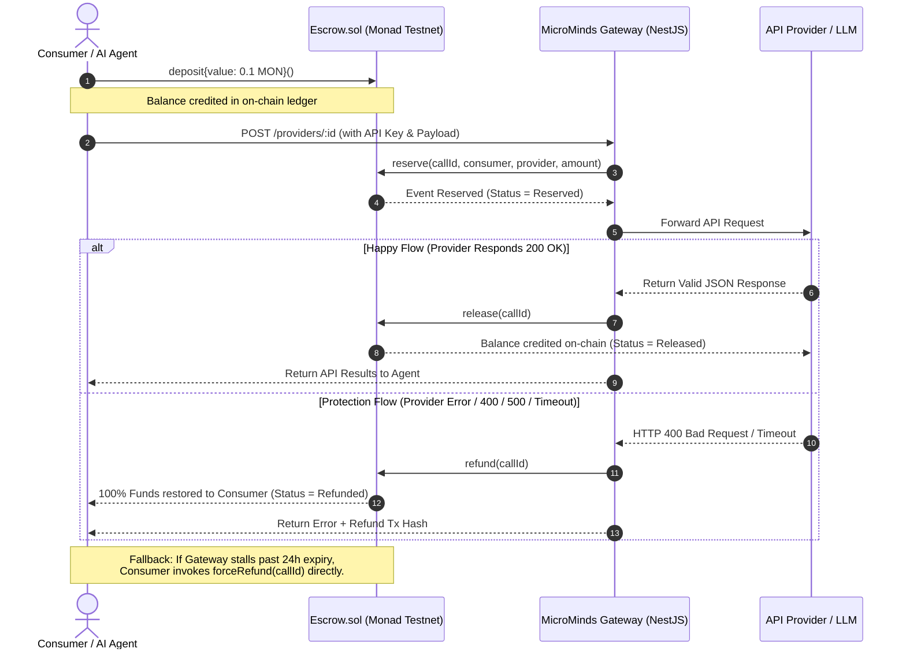

# MicroMinds 🧠⚡️

[](https://github.com/westoryyyy/MicroMinds/actions/workflows/ci.yml)
-836EF9?style=flat-square)


> **The Decentralized Pay-per-Call API Marketplace & Smart Contract Escrow Protocol for the Autonomous AI Agent Economy.**

Built for the **Monad Metropolis Hackathon** (Track: *Trust, Identity & Infrastructure*).

---

## 📌 Executive Summary

As AI agents become increasingly autonomous, they need to transact machine-to-machine (M2M)—purchasing datasets, paying for compute, or executing specialized micro-tasks. However, existing Web2 payment rails are fundamentally built for humans and credit cards, creating **Subscription Fatigue** and a massive **Trust Gap**.

**MicroMinds** is an on-chain trust and payment layer that enables AI agents to discover, consume, and monetize micro-services on a strictly **pay-per-call** basis. Secured by an automated **Escrow Smart Contract on Monad**, funds are only released to providers when API responses are verified, with guaranteed 100% automatic refunds if an API fails.

---

## ❌ The Problem: Subscription Fatigue & The Trust Gap

1. **Subscription Fatigue:** If an AI agent only needs 5 API calls to complete an ad-hoc task, the developer is forced to sign up for a $20–$50/month recurring subscription.
2. **The Trust Dilemma:** 
   - If the Consumer Agent pays upfront, a malicious or crashing provider can take the money without delivering a response.
   - If the Provider delivers first, a malicious consumer might refuse to pay.
3. **Execution Bottleneck:** Asking a human to approve a MetaMask transaction popup for every $0.001 micro-service destroys true agent autonomy.
4. **Blockchain Scalability:** Traditional L1 blockchains are too slow and expensive for high-frequency micro-payments.

---

## 💡 The MicroMinds Solution

* **Zero-Subscription Microtransactions:** Pay eceran (as low as $0.001) per API call using native Monad tokens (`MON`).
* **Trustless Escrow Guarantee:** Funds are temporarily "Reserved" on-chain. If the API returns `200 OK`, funds are **Released**. If it fails, times out, or returns bad data, funds are instantly **Refunded**.
* **High-Throughput on Monad:** Sub-second block times and sub-cent gas fees allow true high-frequency agentic micropayments without overhead.
* **Native Model Context Protocol (MCP):** Compatible with Anthropic's MCP standard. AI agents in Cursor, Claude Desktop, or LangChain can plug into MicroMinds with a single configuration line.

---

## 🔄 How It Works: System Architecture & Lifecycle

MicroMinds uses a high-performance **Pull-over-Push** escrow architecture coordinated by an off-chain Gateway Operator.



### Detailed Lifecycle Steps:
1. **Deposit:** The consumer deposits native `MON` once into `Escrow.sol`.
2. **Reservation:** When an API call is initiated, the Gateway Operator calls `reserve()`. The exact cost is deducted from the consumer's escrow balance and assigned to a unique `callId`.
3. **Execution & Verification:** The Gateway executes the microservice (e.g. running real smart contract audits via OpenRouter LLMs).
4. **Resolution:**
   - **Success (Release):** Upon a valid HTTP response, `release(callId)` transfers the reserved amount to the provider's balance.
   - **Failure (Refund):** If the provider fails, times out, or returns invalid schemas, `refund(callId)` immediately restores the reserved amount to the consumer.
5. **Withdrawal:** Users and providers can call `withdraw(amount)` at any time to pull their earnings back to their personal wallet.

---

## 🤖 For AI Agents: Model Context Protocol (MCP)

MicroMinds is built from the ground up for the agentic era. Any MCP-enabled client (Cursor, Claude Desktop, Windsurf) can connect to our marketplace:

### Quickstart with `npx`:
Add this to your `claude_desktop_config.json` or Cursor MCP settings:

```json
{
  "mcpServers": {
    "microminds": {
      "command": "npx",
      "args": ["-y", "microminds-mcp"],
      "env": {
        "MICROMINDS_API_KEY": "your_api_key_here",
        "MICROMINDS_BASE_URL": "http://localhost:3001"
      }
    }
  }
}
```

### Available MCP Tools:
* `search_api`: Search active listings by category or keyword (`security`, `trading`, `data`).
* `call_api`: Invoke a listing with dynamic payloads, handling on-chain escrow reservation and payout automatically.
* `get_balance`: Check current escrow balance and API quota.

---

## 🛠️ Infra & DevOps Architecture

| Component | Technology | Role & Deployment |
|---|---|---|
| **Smart Contract** | Solidity `^0.8.24` + Foundry | On-Chain Escrow Protocol on Monad Testnet (`10143`) |
| **Backend API** | NestJS + TypeScript | Off-chain API Gateway, Operator, LLM Provider Orchestrator |
| **Frontend Web** | Next.js 16 + React 19 + TailwindCSS | Interactive Marketplace, Web Playground, Docs |
| **Auth & Wallets** | Privy | Embedded wallets, social logins, automated delegated signing |
| **Database** | PostgreSQL (Railway) | API keys, listing directory, call execution history |
| **Event Indexer** | Envio (HyperIndex) | Real-time indexing of on-chain Escrow events |
| **CI / CD Pipeline** | GitHub Actions | Automated typecheck, build verification, and quality gates |
| **Cloud Hosting** | Vercel (Frontend), Railway (Backend) | 24/7 Production-grade cloud deployment |

---

## 🔗 On-Chain Deployments (Monad Testnet)

* **Network:** Monad Testnet
* **Chain ID:** `10143`
* **RPC Endpoint:** `https://testnet-rpc.monad.xyz`
* **Escrow Contract Address:** [`0x5c7141ab4d637915858ee97881fd613af468c76a`](https://testnet.monadscan.com/address/0x5c7141ab4d637915858ee97881fd613af468c76a)
* **Contract Features:** `Ownable2Step`, `ReentrancyGuard`, zero-token native MON handling, non-custodial pull architecture.

---

## 🗂️ Monorepo Structure

```text
MicroMinds/
├── .github/workflows/       # GitHub Actions CI/CD Pipeline
│   └── ci.yml               # Automated Backend & Frontend build checks
├── backend/                 # NestJS API Gateway & MCP Server
│   ├── apps/api/            # Core REST API Gateway & LLM Orchestrator
│   ├── packages/mcp-server/ # Model Context Protocol (MCP) server package
│   └── package.json         # Workspace scripts & dependencies
├── frontend/                # Next.js 16 Web Marketplace & Playground
│   ├── src/app/             # App Router pages (Dashboard, Explore, Docs, Dev)
│   ├── src/components/      # UI Components, Navbar, Wallet Connectors
│   └── package.json         # Frontend dependencies & Next.js config
├── smart-contract/          # Escrow protocol reference (Solidity)
│   ├── src/Escrow.sol       # Core Escrow contract
│   └── test/Escrow.t.sol    # 26 Foundry unit & fuzz tests (100% passing)
├── LICENSE                  # MIT License
└── README.md                # Project documentation
```

---

## 🚀 Local Development Quickstart

### Prerequisites
* Node.js `>= 20.0.0`
* `pnpm >= 9.0.0`
* [Foundry](https://getfoundry.sh/) (optional, for contract testing)

### 1. Clone & Install
```bash
git clone https://github.com/westoryyyy/MicroMinds.git
cd MicroMinds
```

### 2. Start Backend API
```bash
cd backend
pnpm install
cp .env.example .env
pnpm dev:api
```
*Backend runs on `http://localhost:3001`.*

### 3. Start Frontend Dashboard
```bash
cd ../frontend
pnpm install
cp .env.local.example .env.local
pnpm dev
```
*Frontend runs on `http://localhost:3000`.*

---

## 🧪 Testing Scenarios (Video Demo Cheatsheet)

To demonstrate the power of zero-trust blockchain escrow during recordings:

### Scenario 1: The Happy Flow (Release)
```bash
curl -X POST http://localhost:3001/providers/x402-audit \
  -H "Content-Type: application/json" \
  -d '{"contract_code": "contract Store { uint256 val; function set(uint256 x) external { val = x; } }"}'
```
* **Result:** Provider returns `200 OK` with real LLM vulnerability analysis. Gateway invokes `release(callId)` on Monad Testnet. Provider is credited.

### Scenario 2: The Protection Flow (Automatic Refund)
```bash
curl -X POST http://localhost:3001/providers/x402-audit \
  -H "Content-Type: application/json" \
  -d '{"contract_code": ""}'
```
* **Result:** Gateway detects `400 Bad Request`. Gateway invokes `refund(callId)` on Monad Testnet. Consumer's funds are restored 100%.

---

## 🏆 Metropolis Hackathon Bounties & Integrations

1. **Monad (Trust, Identity & Infrastructure):** Primary protocol settlement layer leveraging Monad's 10,000 TPS and 1-second finality to make sub-cent API micro-escrow practical.
2. **Privy:** Gasless onboarding, social logins, and delegated server-side key management for autonomous AI agent transactions.
3. **Alchemy:** Low-latency RPC node infrastructure powering operator transaction broadcasts on Monad Testnet.
4. **Envio:** Real-time event indexing for `Reserved`, `Released`, and `Refunded` on-chain lifecycle tracking.

---

## 📄 License

This project is licensed under the [MIT License](./LICENSE) - see the LICENSE file for details.  
Copyright (c) 2026 Team Ketupat / Metropolis Hackathon.
