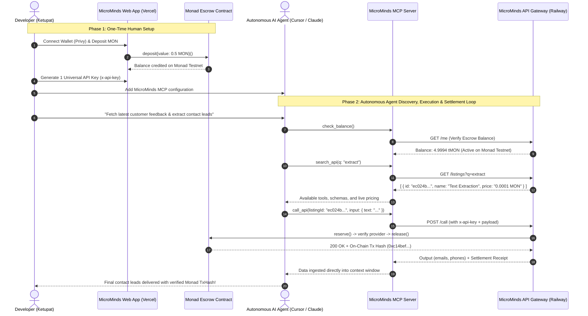
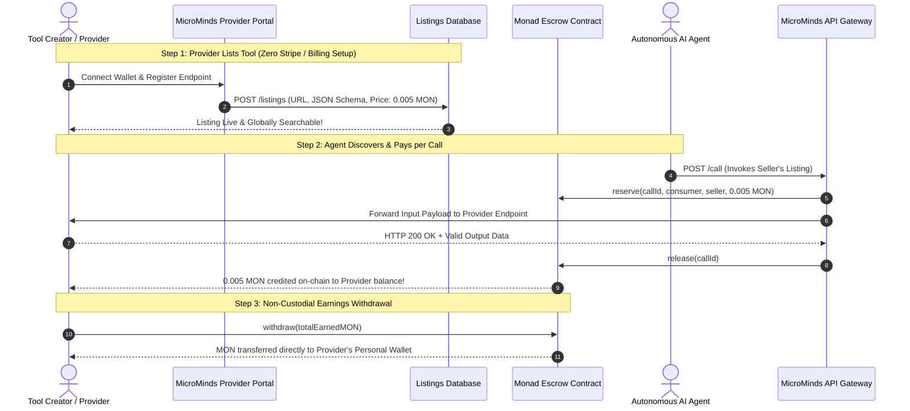
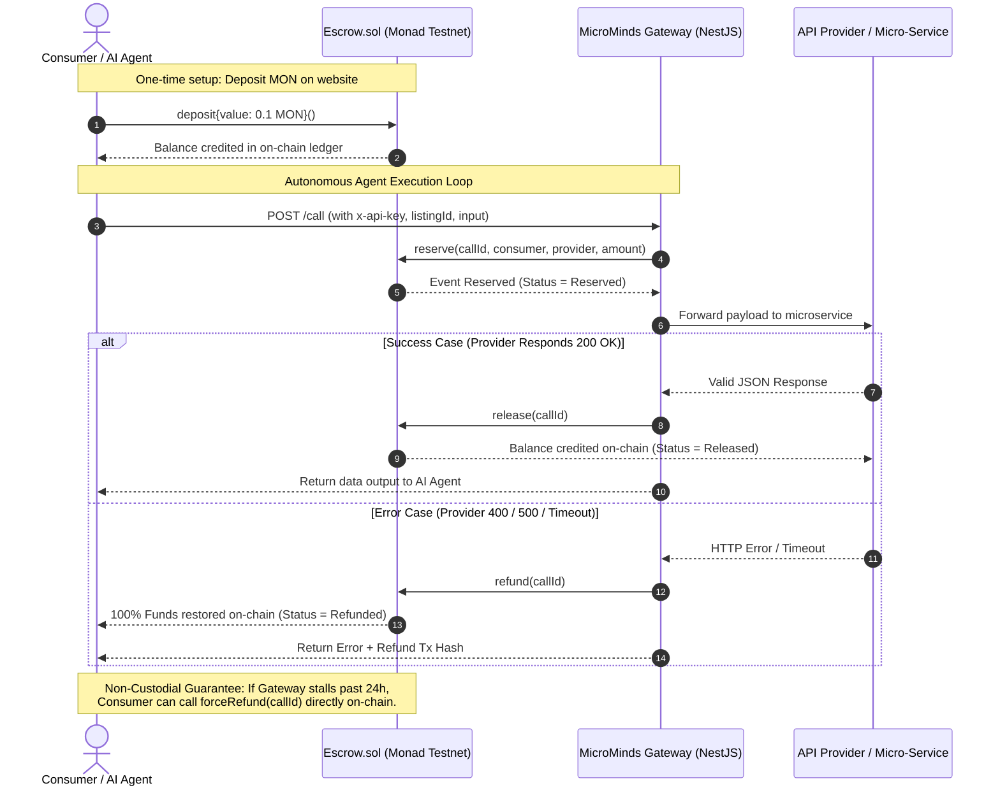

<div align="center">


# MicroMinds

### The Decentralized Tool Gateway & Smart Contract Escrow Protocol for Autonomous AI Agents

*The OpenRouter for AI Agent Tools. Deposit MON, get 1 API key, and let autonomous agents discover, invoke, and settle micro-APIs via trustless on-chain escrow on Monad.*

<br/>

[-836EF9?style=flat-square)](https://testnet.monadscan.com/address/0x5c7141ab4d637915858ee97881fd613af468c76a)
[](https://modelcontextprotocol.io)
[](./LICENSE)
[](https://monad.xyz)

<br/>

[🌐 Live App](https://www.microminds.tech) &nbsp;&bull;&nbsp;
[📖 How it Works](https://www.microminds.tech/docs) &nbsp;&bull;&nbsp;
[⚡ API Gateway](https://microminds-production.up.railway.app) &nbsp;&bull;&nbsp;
[📜 Smart Contract](https://testnet.monadscan.com/address/0x5c7141ab4d637915858ee97881fd613af468c76a)

</div>

---

## ⚡ The Problem: Why Autonomous AI Agents Are Paralyzed & Broke

Meet **Ketupat**, an AI engineer building autonomous multi-agent systems in Cursor and Claude. Ketupat's agents are capable of remarkable multi-step reasoning. But the moment an agent needs to perform real-world tasks—scraping live data, formatting messy JSON, verifying a smart contract, or running specialized financial queries—it hits a brick wall.

**Web2 payment rails were built for humans with credit cards, not autonomous machines with code.**

Every time Ketupat's agent needs an external capability, it encounters four major friction points:

| Friction Point | Traditional Web2 Pain (Today) | Why It Breaks AI Agents |
| :--- | :--- | :--- |
| **💳 SaaS Subscription Trap** | Ketupat pays $250+/month across 6 separate SaaS platforms | Tools only needed 5 times a week, but billed as recurring monthly plans |
| **🔑 API Key Sprawl** | Juggling 10 developer portals, 10 `.env` keys, and rate limits | High maintenance overhead and brittle production setups |
| **🤖 Zero Agent Commerce** | Machine execution halts at credit card, 2FA, and checkout gates | Agents cannot fill checkout forms or approve MetaMask popups mid-loop |
| **⚖️ The Trust Dilemma** | Pre-paying unverified APIs risks rug-pulls; delivering first invites scraping | Zero escrow protection or verification in traditional HTTP APIs |

---

## 💡 The Solution: MicroMinds — The OpenRouter for AI Agent Tools

**MicroMinds** removes human friction from the machine commerce loop completely. 

Instead of forcing developers to buy subscriptions or manually approve transactions, MicroMinds introduces a unified **Discovery, Execution & Escrow Protocol** powered by Monad's high-speed consensus:

| Phase | Actor | Action & Mechanism |
| :--- | :--- | :--- |
| **1. One-Time Setup** | **Ketupat** *(Human Developer)* | Connects Monad wallet once $\rightarrow$ Deposits `MON` into `Escrow.sol` $\rightarrow$ Generates universal `x-api-key`. |
| **2. Autonomous Discovery** | **AI Agent** *(Autonomous)* | Calls `search_api("data extraction")` via MCP to find live tool listings, prices, and schemas. |
| **3. Autonomous Execution** | **AI Agent** *(Autonomous)* | Calls `call_api(listingId, input)` directly—zero human approval or checkout forms needed. |
| **4. On-Chain Settlement** | **Monad Escrow Protocol** | Reserves funds on Monad $\rightarrow$ verifies response $\rightarrow$ releases MON upon success (or 100% refund). |

### The Three Core Pillars:
1. **One Universal Key (`x-api-key`):** Access hundreds of community and enterprise micro-APIs through a single credential. No more API key sprawl.
2. **One On-Chain Escrow Balance:** Deposit native `MON` once. Pay strictly **per call** (as low as $0.001 / call) directly from the smart contract escrow ledger.
3. **Autonomous Discovery (No Human Shopping Carts):** Humans never shop manually on the website. The website is strictly a setup panel and discovery showcase. The AI Agent itself dynamically queries `/listings`, picks the best tool, and executes it on the fly.

---

## 🏪 The Provider Opportunity: Monetize Micro-APIs for Machines

The next billion API consumers aren't humans reading documentation—**they are autonomous AI agents executing code 24/7**.

Until now, developers building specialized utilities (e.g. smart contract vulnerability scanners, dynamic web scrapers, or token risk analyzers) had no viable way to monetize them:

* **Stripe & PayPal overhead** is economically impossible for $0.002 micro-transactions.
* **Human users won't subscribe** to niche utilities they only need occasionally.
* **Non-payment risk:** Delivering data upfront leaves providers vulnerable to unpaid scraping.

### How MicroMinds Empowers Sellers:
* **List in 60 Seconds:** Connect your wallet, register your endpoint URL, specify input/output schemas, and set your price in native `MON` (e.g. `0.005 MON / call`).
* **Guaranteed Settlement (Zero Non-Payment Risk):** Before any payload reaches your server, the Gateway verifies that consumer funds are already securely locked (`reserve`) on Monad. When your API returns `200 OK`, Monad's smart contract instantly credits your balance (`release`).
* **Non-Custodial Direct Withdrawals:** Providers can invoke `withdraw(amount)` directly on `Escrow.sol` at any time to pull accumulated MON straight into their personal wallet.
* **Instant Global Distribution:** Once listed, your tool is immediately searchable via `search_api` to thousands of autonomous agents running on Claude Desktop, Cursor, and LangChain worldwide.

---

## 💼 Business Model & Sustainable Unit Economics

MicroMinds is architected from the ground up to monetize **high-frequency, machine-to-machine commerce** where traditional Web2 payment aggregators fail.

### 💰 Four Diversified Revenue Streams:

| Revenue Stream | Mechanism | Target Audience | Projected Economics |
| :--- | :--- | :--- | :--- |
| **1. Protocol Take-Rate** | **2.5% fee** deducted on-chain upon successful `release()` of funds | All Tool Providers | 0% on Testnet; 2.5% on Mainnet. Highly scalable across millions of daily agent calls. |
| **2. Staked Tool Discovery** | Providers stake `MON` to boost ranking and trust score in `search_api` results | Tool Creators & Sellers | Locked liquidity reduces circulating MON supply while generating curation yields. |
| **3. Enterprise Agent Gateway** | Dedicated egress infrastructure, custom rate-limits, and guaranteed TPS SLAs | Enterprise AI Agent Swarms | Tiered B2B subscription for hedge funds, legal tech, and automated auditing swarms. |
| **4. Serverless Tool Hosting** *(Roadmap)* | 1-Click containerized microservice hosting with built-in escrow integration | Independent Developers | Infrastructure margin on decentralized serverless compute and egress bandwidth. |

---

### 📊 The Micro-Transaction Math: Why Web2 Fails & Monad Wins

Traditional payment processors make micro-transactions economically unviable. MicroMinds leverages Monad's parallel architecture to make sub-cent transactions profitable:

| Economic Metric | Web2 Payment Rails (Stripe / PayPal) | Traditional EVM / L2s | **MicroMinds on Monad** |
| :--- | :--- | :--- | :--- |
| **Target Transaction Size** | $10.00 – $250.00 | $5.00 – $50.00 | **$0.001 – $0.05 per API call** |
| **Fixed Processing Fee** | $0.30 per transaction | $0.05 – $2.50 (Gas volatility) | **<$0.0001 per transaction** |
| **Effective Fee on $0.002 Call** | **1,500%** *(Completely Impossible)* | **2,500%** *(Unviable for Agents)* | **2.5% protocol fee ($0.00005)** |
| **Settlement Time** | 2 – 5 business days | 12 – 60 seconds | **Sub-second atomic settlement** |
| **Refund Mechanism** | Manual dispute (chargeback fee) | Manual multisig interaction | **Automated 100% on-chain refund** |

---

### 🛡️ Competitive Moat: The Flywheel of Autonomous Commerce

```text
               +-------------------------------------------+
               |  More Autonomous Agents (Cursor / Claude) |
               +---------------------+---------------------+
                                     |
                                     ▼
                      +-----------------------------+
                      | Higher Daily Transaction    |
                      | Volume Settled in MON       |
                      +--------------+--------------+
                                     |
                                     ▼
   +-------------------------+       |       +-------------------------+
   | Lower Per-Call Fees &   |<------+------>| Greater Revenue for     |
   | Deeper Tool Liquidity   |               | Tool Creators (Sellers) |
   +-------------------------+               +-------------------------+
                                     ▲
                                     |
               +---------------------+---------------------+
               | More Specialized Tools & Micro-APIs Listed |
               +-------------------------------------------+
```

1. **First-Mover MCP Advantage:** By deploying native Model Context Protocol (MCP) servers, MicroMinds becomes the default runtime tool provider for developers in Claude Desktop and Cursor.
2. **Defensible Network Effects:** As more AI agents query `/listings`, providers receive immediate paying machine traffic, attracting more tool creators and deepening the catalog.
3. **Trustless On-Chain Moat:** Unlike centralized API aggregators that can withhold payouts, MicroMinds' non-custodial `Escrow.sol` contract ensures sellers can pull their accumulated MON at any time, cementing provider loyalty.

---

## 🔄 Sequence Diagrams

### 1. Developer Setup & Autonomous Agent Discovery (MCP)
How a human configures once, and how the AI Agent autonomously discovers and consumes tools via MCP without any manual human purchasing:



---

### 2. Provider Lifecycle: Listing, Execution & Non-Custodial Earnings
How developers list their microservices, earn MON per call, and withdraw revenue non-custodially:



---

### 3. On-Chain Escrow Lifecycle & Fault-Tolerant Settlement on Monad
How the off-chain Gateway Operator and on-chain `Escrow.sol` contract protect funds with atomic reservation, verification, and instant refunds:



---

## 🤖 For AI Agents: Model Context Protocol (MCP)

MicroMinds natively supports Anthropic's **Model Context Protocol (MCP)**. Any MCP-compliant environment (**Claude Desktop**, **Cursor IDE**, **Zed**, **Windsurf**, or **Antigravity**) can instantly discover and invoke tools.

### 1. Add Configuration
Add this to your `claude_desktop_config.json` or Cursor MCP settings (`~/.cursor/mcp.json`):

```json
{
  "mcpServers": {
    "microminds": {
      "command": "npx",
      "args": ["-y", "microminds-mcp"],
      "env": {
        "MICROMINDS_API_KEY": "mm_your_api_key_here",
        "MICROMINDS_BASE_URL": "https://microminds-production.up.railway.app"
      }
    }
  }
}
```

### 2. The Three Universal Autonomous Agent Primitives

When installed, your AI Agent gains access to three universal MCP tools:

| MCP Tool Primitive | Function & Purpose | Autonomous Machine Behavior |
| :--- | :--- | :--- |
| **`check_balance`** | Autonomous Financial Awareness | Checks current available prepaid `tMON` balance and wallet status on Monad Testnet before or after shopping micro-APIs. |
| **`search_api`** | Dynamic Tool Discovery | Searches the MicroMinds registry dynamically by capability keyword or max price in wei. |
| **`call_api`** | Escrow Execution & Settlement | Executes the target micro-API with atomic on-chain reservation, output ingestion, and Monad settlement receipt. |

---

### 3. Tested Ready-to-Use Natural Prompts

Copy and paste any of these tested prompts directly into your AI chat (Claude Desktop, Cursor, or VS Code):

* **🔍 Prompt A (Discovery):**
  > *"Please search the MicroMinds marketplace for available AI tools and API services on Monad."*
* **💳 Prompt B (Autonomous Balance Check):**
  > *"Please check my available tMON balance on MicroMinds to see if I have enough funds for micro-API calls."*
* **⚡ Prompt C (Lead & Contact Extraction):**
  > *"Morning! Can you search MicroMinds for an API on Monad, and buy/call it to extract emails and phone numbers from: 'Hey! Contact our team at partnerships@innovatecorp.com or +1-800-555-0199'?"*
* **🔗 Prompt D (OpenGraph Link Preview):**
  > *"In index.html, borrow the URL Metadata API from MicroMinds to generate preview card details for 'https://monad.xyz' on Monad testnet."*

---

## ⚡ Verified Live Execution on Monad Testnet

MicroMinds is live in production. Here is an authentic, untampered payload returned by an autonomous AI agent in **VS Code & Cursor** executing an on-chain extraction call via MicroMinds:

```json
{
  "callId": "0x65948e7454369e200e31d491a5ead1824a92bee7d8a26b64b586b3906a22f32f",
  "status": "released",
  "output": {
    "emails": [
      "partnerships@innovatecorp.com"
    ],
    "phones": [
      "+1-800-555-0199"
    ]
  },
  "settlement_receipt": {
    "status": "released",
    "network": "Monad Testnet",
    "cost": "0.000100 tMON",
    "costWei": "100000000000000",
    "txHash": "0xc14bef8e279978c5d8e27e371385841b32817e81c9e57aa24c332dfad501aa9",
    "explorerUrl": "https://testnet.monadexplorer.com/tx/0xc14bef8e279978c5d8e27e371385841b32817e81c9e57aa24c332dfad501aa9",
    "escrow": "MicroMinds Escrow Protocol"
  }
}
```

> **🛡️ Zero-Risk Escrow Guarantee:** If an external provider times out or returns an HTTP 500 error, Monad's smart contract automatically executes a **100% on-chain refund** to the consumer wallet. Zero funds are ever lost on failed executions.

---

## 🌐 Universal AI Agent Ecosystem Compatibility

MicroMinds is designed exclusively for the **Autonomous Agent Economy**. Any environment supporting Anthropic's Model Context Protocol (MCP) integrates seamlessly out of the box:

```text
                  +-----------------------------------+
                  |      MicroMinds Gateway & Escrow  |
                  |     (Monad Testnet Settlement)    |
                  +-----------------+-----------------+
                                    |
         ┌──────────────────────────┼──────────────────────────┐
         ▼                          ▼                          ▼
   [ Desktop AI ]            [ Coding IDEs ]          [ Autonomous Swarms ]
   Claude Desktop,           Cursor, VS Code (Cline),  LangChain, CrewAI,
   Antigravity               Windsurf, Zed, Devin      AutoGPT, ElizaOS
```

All interactions happen through native tool calls (`check_balance`, `search_api`, `call_api`) without human friction or manual checkout processes.

---

## 🛠️ Infrastructure & Tech Stack Overview

| Layer | Component | Technology | Role & Deployment |
|---|---|---|---|
| **Consensus & Settlement** | Escrow Contract | Solidity `^0.8.24` + Foundry | On-Chain Escrow Protocol on Monad Testnet (`10143`) |
| **Real-Time Event Indexing**| Sub-Second Indexer | Envio HyperIndex | Indexing `Escrow.sol` events into GraphQL (`Call`, `Balance`, `Deposit`) |
| **RPC & Node Infrastructure**| Monad Connection | Alchemy | Enterprise Monad Testnet RPC powering Operator Signer & Viem reads |
| **API Gateway & Operator** | Backend API | NestJS + TypeScript | Off-chain API Gateway, Operator Signer, LLM Provider Orchestrator on Railway |
| **Marketplace & Dashboard**| Frontend Web | Next.js 16 + React 19 + TailwindCSS | Wallet Connection, Escrow Deposit UI, Key Generator, Docs on Vercel |
| **Identity & Delegation**  | Web3 Auth | Privy | Social logins, embedded wallets, and session validation |
| **Database**               | Persistence | PostgreSQL (Railway) | API key hashes, tool registry, call audit logs |
| **Tool Protocol**          | Agent Plugin | `@modelcontextprotocol/sdk` | MCP Server providing `check_balance`, `search_api` & `call_api` |
| **CI / CD Pipeline**       | Quality Gates | GitHub Actions | Automated linting, typechecks, and build validations |

---

## 🔗 On-Chain Escrow Contract Details

* **Network:** Monad Testnet
* **Chain ID:** `10143`
* **RPC Endpoint:** `https://testnet-rpc.monad.xyz`
* **Escrow Address:** [`0x5c7141ab4d637915858ee97881fd613af468c76a`](https://testnet.monadscan.com/address/0x5c7141ab4d637915858ee97881fd613af468c76a)
* **Contract Architecture:**
  * Native MON balance tracking (zero ERC-20 token wrapper friction).
  * Automated `reserve()`, `release()`, and `refund()` lifecycle methods.
  * Non-custodial safety: Users can execute `forceRefund(callId)` if the off-chain operator fails to resolve an expired call.
  * Hardened with OpenZeppelin `ReentrancyGuard` and `Ownable2Step`.

---

## 🗂️ Monorepo Structure

```text
MicroMinds/
├── .github/workflows/       # GitHub Actions CI/CD Pipeline
├── backend/                 # NestJS API Gateway, Envio Indexer & MCP Server
│   ├── apps/api/            # Core REST API Gateway & Escrow Operator (Viem + Alchemy)
│   ├── apps/indexer/        # Envio HyperIndex real-time event indexer & GraphQL API
│   ├── packages/mcp-server/ # Model Context Protocol (MCP) server package
│   └── package.json         # Workspace scripts & dependencies
├── frontend/                # Next.js 16 Web Marketplace & Dashboard
│   ├── src/app/             # App Router pages (Dashboard, Explore, Docs, Dev)
│   ├── src/components/      # UI Components, Crayon Badges, Wallet Connectors
│   ├── src/lib/envio.ts     # Declarative Envio GraphQL client integration
│   └── package.json         # Frontend dependencies & Next.js config
├── smart-contract/          # Escrow protocol reference (Solidity)
│   ├── src/Escrow.sol       # Core Escrow contract
│   └── test/Escrow.t.sol    # 26 Foundry unit & fuzz tests (100% passing)
├── LICENSE                  # MIT License
└── README.md                # Flagship project documentation
```

---

## 🚀 Local Development Quickstart

### Prerequisites
* Node.js `>= 20.0.0`
* `pnpm >= 9.0.0`
* [Foundry](https://getfoundry.sh/) (optional, for contract unit tests)

### 1. Clone & Install
```bash
git clone https://github.com/westoryyyy/MicroMinds.git
cd MicroMinds
```

### 2. Start Backend API
```bash
cd backend
pnpm install
cp .env.example .env
pnpm dev:api
```
*Backend runs on `http://localhost:3001`.*

### 3. Start Frontend Dashboard
```bash
cd ../frontend
pnpm install
cp .env.local.example .env.local
pnpm dev
```
*Frontend runs on `http://localhost:3000`.*

---

## 🏆 Monad Metropolis Hackathon Track Fit

### 🎯 Primary Track: Trust, Identity & Infrastructure
* **Trust:** Trustless payment escrow (`Escrow.sol`) guarantees that neither AI consumers nor tool providers can be cheated. Funds are programmatically released only upon 200 OK delivery.
* **Identity:** Privy embedded wallets seamlessly bridge Web2 users and autonomous Web3 agents with single-deposit onboarding.
* **Infrastructure:** Leverages Monad’s 10,000 TPS, sub-second block times, and microscopic gas fees to make sub-cent machine-to-machine micropayments economically feasible for the first time.

### 💎 Sponsor Integrations & Bounties
* **⚡ Envio (HyperIndex):** Indexes on-chain `Escrow.sol` events (`Reserved`, `Released`, `Refunded`) in sub-second time on Monad Testnet (`10143`). Eliminates RPC polling lag and directly powers the live Consumer Audit Ledger and Provider Revenue Dashboard via declarative GraphQL queries (`backend/apps/indexer/`).
* **🔮 Alchemy (RPC Infrastructure):** Provides enterprise-grade node connections on Monad Testnet for our automated NestJS operator signer and Viem clients. Handles high-frequency automated transaction broadcasts with zero dropped nonces or rate-limiting.
* **🔐 Privy (Embedded Wallets & Auth):** Delivers zero-friction social/wallet onboarding on Monad Testnet. Decouples human identity from autonomous machine execution via `@privy-io/react-auth` on the frontend and `@privy-io/node` on backend API guards.

---

## 👥 Team Ketupat

| Name | Role | Focus |
| :--- | :--- | :--- |
| **Nabilah Aprilia Darwin** | UI/UX Designer | User experience design, wireframing, crayon aesthetic design system & custom UI visual assets |
| **Renatha Amelia Manggala Putri** | Frontend & Backend Engineer | Next.js 16 Marketplace UI, fullstack API integration, Privy embedded wallets & Envio GraphQL hooks |
| **Grace Yoelanda Turnip** | Backend & AI Engineer | NestJS API Gateway, MCP server orchestration, agent tool execution pipelines & Viem + Alchemy RPC |
| **Rotua Paulina** | Product Manager & Smart Contract Engineer | Product strategy & roadmap, cross-functional execution, core `Escrow.sol` protocol & Monad deployment |

---

## 📄 License

This project is licensed under the [MIT License](./LICENSE) - see the LICENSE file for details.  
Copyright (c) 2026 Team Ketupat.
