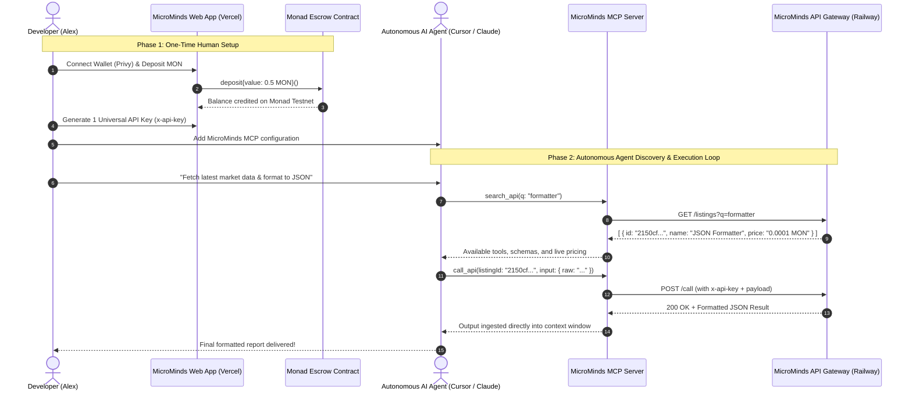
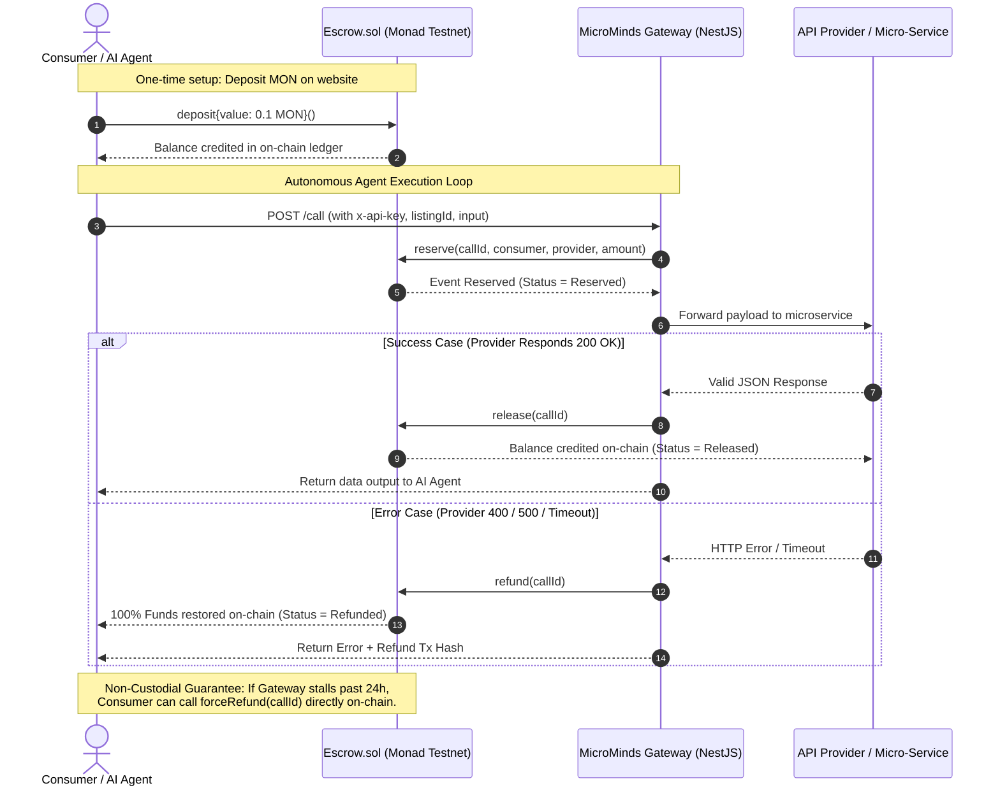

# MicroMinds 🧠⚡️

[](https://github.com/westoryyyy/MicroMinds/actions/workflows/ci.yml)
-836EF9?style=flat-square)


> **The Decentralized Tool Gateway & Smart Contract Escrow Marketplace for Autonomous AI Agents.**  
> *Inspired by the universal routing paradigm of OpenRouter, but purpose-built for AI Agent Micro-APIs, dynamic tool discovery, and trustless escrow micropayments on Monad.*

Built for the **Monad Metropolis Hackathon** (Track: *Trust, Identity & Infrastructure*).

**Live Deployments:**
* **Frontend Web:** [https://microminds-monad.vercel.app](https://microminds-monad.vercel.app)
* **API Gateway (Railway):** [https://microminds-production.up.railway.app](https://microminds-production.up.railway.app)
* **Escrow Contract (Monad Testnet):** [`0x5c7141ab4d637915858ee97881fd613af468c76a`](https://testnet.monadscan.com/address/0x5c7141ab4d637915858ee97881fd613af468c76a)

---

## 📖 The Developer's Story: The Broken Agent Economy

Meet **Alex**, an AI engineer building an autonomous multi-agent assistant in Cursor and Claude Desktop. Alex's agent is capable of deep reasoning, but to deliver real-world value, it needs specialized external tools: extracting data from messy URLs, formatting unreadable JSON blobs, executing on-chain contract audits, and querying niche financial signals.

Every time Alex wants the agent to accomplish an ad-hoc task, Alex hits four insurmountable friction walls:

### 1. The Credit Card & SaaS Subscription Trap
To give the agent access to 6 different niche utilities, Alex is forced to subscribe to 6 separate SaaS platforms at $20–$50/month each ($200+/month in fixed recurring overhead). The agent might only need to run a JSON formatter 5 times a week, but Alex pays full monthly subscription prices anyway.

### 2. API Key Sprawl & Maintenance Nightmare
Alex now has to register on 6 different developer portals, store 6 different API keys in `.env` files, monitor 6 separate rate-limit quotas, and manually update configs whenever a provider changes their endpoints.

### 3. The Broken Autonomy Loop (Zero Agent Commerce)
True autonomy means the agent should be able to solve novel problems independently. When Alex's agent encounters a task requiring a tool it doesn't currently possess, it cannot buy it on its own. AI agents do not have credit cards, cannot fill out Web2 checkout carts, and cannot ask Alex to approve a MetaMask popup for every $0.001 micro-service without destroying the unattended execution loop.

### 4. The Two-Sided Trust Dilemma
* If the agent pre-pays an unverified third-party microservice, the server might crash or fail, taking the money with zero recourse.
* If the service provider delivers output first, malicious consumers can scrape the results and refuse to pay.

---

## 💡 The MicroMinds Paradigm: One Key, One Escrow, Autonomous Discovery

**MicroMinds** eliminates human friction from the agent commerce loop entirely.

```
+-----------------------------------------------------------------------------------+
|                            THE MICROMINDS WORKFLOW                                |
|                                                                                   |
|  [ Alex (Human Developer) ]                                                       |
|        │                                                                          |
|        ├─ 1. Connects Monad Wallet once at microminds-monad.vercel.app            |
|        ├─ 2. Deposits MON into the non-custodial Escrow.sol Smart Contract        |
|        ├─ 3. Generates 1 Universal API Key (x-api-key)                            |
|        └─ 4. Installs MicroMinds MCP Server / Skill into their Agent              |
|                                                                                   |
|  [ The Autonomous AI Agent ] (Zero Human Intervention Required)                   |
|        │                                                                          |
|        ├─ 1. Needs a tool? Agent calls search_api("data extraction")              |
|        ├─ 2. Evaluates live listings, pricing (wei), and performance latency     |
|        ├─ 3. Calls call_api(listingId, input) autonomously                        |
|        └─ 4. Gateway locks escrow -> verifies output -> releases MON on-chain     |
+-----------------------------------------------------------------------------------+
```

### Key Principles:
1. **Zero E-Commerce Cart Friction:** There is **NO manual shopping or item checkout on the website**. The website is strictly a setup and control panel: connect wallet, deposit MON, generate API key, and view the public catalog showcase.
2. **Autonomous Tool Discovery:** The agent itself discovers available tools by querying the live registry (`GET /listings` or via MCP `search_api`).
3. **Pay-per-Call Micropayments:** Every tool costs pennies or fractions of a cent (e.g. 0.0001 MON), deducted per call directly from the user's escrow deposit.
4. **Guaranteed Escrow Protection on Monad:** Sub-second block times and sub-cent gas fees on Monad enable real-time on-chain fund reservation. If the API returns valid data, funds are **Released** to the provider. If it errors, times out, or returns corrupted payloads, funds are **100% automatically Refunded** to the consumer.

---

## 🔄 Interaction Flow 1: Developer Setup & Autonomous Agent Discovery (MCP)

This diagram shows how a human sets up once, and how the AI Agent autonomously discovers and consumes tools via MCP without any manual human purchasing:



---

## 🔐 Interaction Flow 2: On-Chain Escrow Lifecycle & Settlement on Monad

This diagram shows how the off-chain Gateway Operator and on-chain `Escrow.sol` contract protect funds with atomic reservation, verification, and instant refunds:

MicroMinds uses a high-performance **Pull-over-Push** escrow architecture coordinated by an off-chain Gateway Operator.



---

## 🤖 For AI Agents: Model Context Protocol (MCP)

MicroMinds supports Anthropic's **Model Context Protocol (MCP)** out of the box. Any MCP-compliant client (**Claude Desktop**, **Cursor IDE**, **Zed**, **Windsurf**, or **Antigravity**) can instantly search and invoke MicroMinds tools.

### 1. Add Configuration
Add this to your `claude_desktop_config.json` or Cursor MCP settings (`~/.cursor/mcp.json`):

```json
{
  "mcpServers": {
    "microminds": {
      "command": "npx",
      "args": ["-y", "microminds-mcp"],
      "env": {
        "MICROMINDS_API_KEY": "mm_your_api_key_here",
        "MICROMINDS_BASE_URL": "https://microminds-production.up.railway.app"
      }
    }
  }
}
```

### 2. Available Autonomous Agent Tools
When installed, your AI Agent gains access to two universal primitives:
* `search_api(q?: string, maxPrice?: string)`: Allows the agent to query the MicroMinds registry dynamically to inspect available tool schemas, pricing, and capabilities.
* `call_api(listingId: string, input: object)`: Allows the agent to execute any listed tool, with automated escrow reservation, verification, and output ingestion.

---

## ⚡ Try It Right Now: Terminal & cURL Test

The MicroMinds production gateway is live globally. You can test it immediately from any terminal on any machine:

### Step 1: Browse Public Listings (No Auth Required)
```bash
curl -s https://microminds-production.up.railway.app/listings | jq .
```

### Step 2: Call an API via the Gateway (Requires API Key)
```bash
curl -X POST https://microminds-production.up.railway.app/call \
  -H "Content-Type: application/json" \
  -H "x-api-key: mm_PASTE_YOUR_API_KEY" \
  -d '{
    "listingId": "2150cfc7-49ed-499b-a3aa-ab291078ef44",
    "input": {
      "raw": "{\"name\":\"Alex\",\"role\":\"AI Engineer\",\"network\":\"Monad\"}"
    }
  }'
```

**Expected Response (200 OK):**
```json
{
  "callId": "73c66f5c-897b-480f-90be-d5b7caeb3a48",
  "status": "released",
  "txHash": "0x4b78f4...",
  "output": {
    "formatted": "{\n  \"name\": \"Alex\",\n  \"role\": \"AI Engineer\",\n  \"network\": \"Monad\"\n}"
  }
}
```

---

## 🌐 Universal Multi-Ecosystem Tech Stack

To ensure MicroMinds can be consumed by any AI agent framework globally, we support three integration tiers:

```text
                  +-----------------------------------+
                  |      MicroMinds Gateway API       |
                  |  https://...railway.app/call      |
                  +-----------------+-----------------+
                                    |
         ┌──────────────────────────┼──────────────────────────┐
         ▼                          ▼                          ▼
   [ Tier 1: MCP ]          [ Tier 2: SDK / Skills ]   [ Tier 3: REST API ]
   Claude Desktop,           LangChain, CrewAI,         cURL, Python requests,
   Cursor, Windsurf,         AutoGPT, ElizaOS,          Node.js fetch, Go,
   Antigravity IDE           OpenAPI schemas            Rust, Discord bots
```

1. **Model Context Protocol (MCP):** Zero-code plugin for desktop coding assistants and IDEs via `npx -y microminds-mcp`.
2. **AI Agent Framework SDK & Skills:** Python and TypeScript clients for multi-agent frameworks (LangChain, CrewAI, AutoGPT). Compatible with standard OpenAPI 3.0 tool definitions.
3. **Universal REST / HTTP:** Simple `POST /call` with `x-api-key` header, callable from any programming language or webhook.

---

## 🛠️ Infrastructure & Tech Stack Overview

| Layer | Component | Technology | Role & Deployment |
|---|---|---|---|
| **Consensus & Settlement** | Escrow Contract | Solidity `^0.8.24` + Foundry | On-Chain Escrow Protocol on Monad Testnet (`10143`) |
| **API Gateway & Operator** | Backend API | NestJS + TypeScript | Off-chain API Gateway, Operator Signer, LLM Provider Orchestrator on Railway |
| **Marketplace & Dashboard**| Frontend Web | Next.js 16 + React 19 + TailwindCSS | Wallet Connection, Escrow Deposit UI, Key Generator, Docs on Vercel |
| **Identity & Delegation**  | Web3 Auth | Privy | Social logins, embedded wallets, and session validation |
| **Database**               | Persistence | PostgreSQL (Railway) | API key hashes, tool registry, call audit logs |
| **Tool Protocol**          | Agent Plugin | `@modelcontextprotocol/sdk` | MCP Server providing `search_api` & `call_api` |
| **CI / CD Pipeline**       | Quality Gates | GitHub Actions | Automated linting, typechecks, and build validations |

---

## 🔗 On-Chain Escrow Contract Details

* **Network:** Monad Testnet
* **Chain ID:** `10143`
* **RPC Endpoint:** `https://testnet-rpc.monad.xyz`
* **Escrow Address:** [`0x5c7141ab4d637915858ee97881fd613af468c76a`](https://testnet.monadscan.com/address/0x5c7141ab4d637915858ee97881fd613af468c76a)
* **Contract Architecture:**
  * Native MON balance tracking (zero ERC-20 token wrapper friction).
  * Automated `reserve()`, `release()`, and `refund()` lifecycle methods.
  * Non-custodial safety: Users can execute `forceRefund(callId)` if the off-chain operator fails to resolve an expired call.
  * Hardened with OpenZeppelin `ReentrancyGuard` and `Ownable2Step`.

---

## 🗂️ Monorepo Structure

```text
MicroMinds/
├── .github/workflows/       # GitHub Actions CI/CD Pipeline
├── backend/                 # NestJS API Gateway & MCP Server
│   ├── apps/api/            # Core REST API Gateway & Escrow Operator
│   ├── packages/mcp-server/ # Model Context Protocol (MCP) server package
│   └── package.json         # Workspace scripts & dependencies
├── frontend/                # Next.js 16 Web Marketplace & Dashboard
│   ├── src/app/             # App Router pages (Dashboard, Explore, Docs, Dev)
│   ├── src/components/      # UI Components, Crayon Badges, Wallet Connectors
│   └── package.json         # Frontend dependencies & Next.js config
├── smart-contract/          # Escrow protocol reference (Solidity)
│   ├── src/Escrow.sol       # Core Escrow contract
│   └── test/Escrow.t.sol    # 26 Foundry unit & fuzz tests (100% passing)
├── LICENSE                  # MIT License
└── README.md                # Flagship project documentation
```

---

## 🚀 Local Development Quickstart

### Prerequisites
* Node.js `>= 20.0.0`
* `pnpm >= 9.0.0`
* [Foundry](https://getfoundry.sh/) (optional, for contract unit tests)

### 1. Clone & Install
```bash
git clone https://github.com/westoryyyy/MicroMinds.git
cd MicroMinds
```

### 2. Start Backend API
```bash
cd backend
pnpm install
cp .env.example .env
pnpm dev:api
```
*Backend runs on `http://localhost:3001`.*

### 3. Start Frontend Dashboard
```bash
cd ../frontend
pnpm install
cp .env.local.example .env.local
pnpm dev
```
*Frontend runs on `http://localhost:3000`.*

---

## 🏆 Monad Metropolis Hackathon Track Fit

* **Trust, Identity & Infrastructure:**
  * **Trust:** Trustless payment escrow guarantees that neither AI consumers nor tool providers can be cheated.
  * **Identity:** Privy embedded wallets seamlessly bridge Web2 users and autonomous Web3 agents.
  * **Infrastructure:** Leverages Monad’s 10,000 TPS, sub-second block times, and microscopic gas fees to make sub-cent machine-to-machine micropayments economically feasible for the first time.

---

## 📄 License

This project is licensed under the [MIT License](./LICENSE) - see the LICENSE file for details.  
Copyright (c) 2026 Team Ketupat / Monad Metropolis Hackathon.
